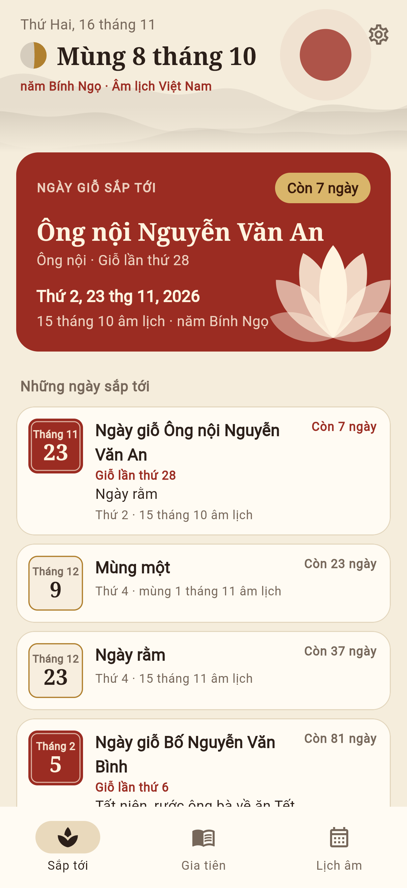
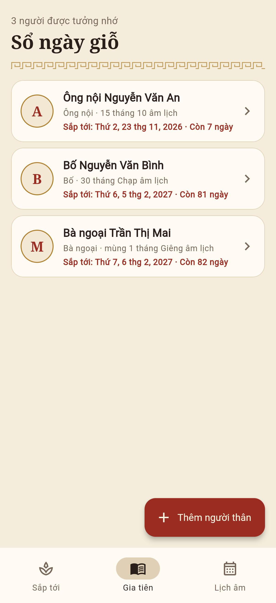
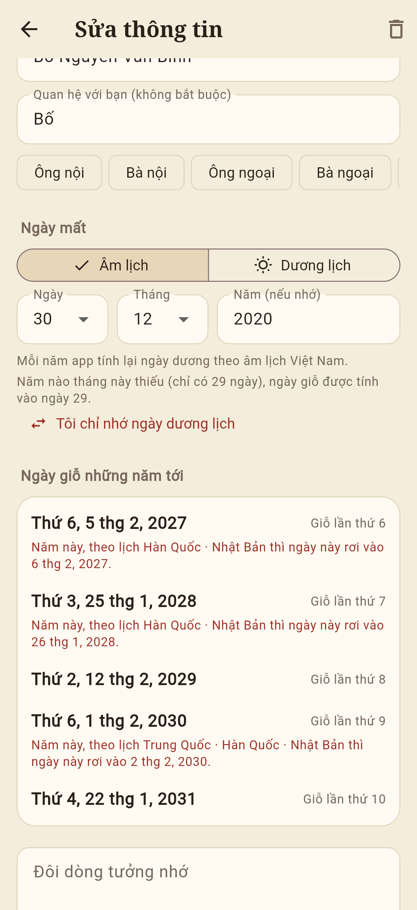
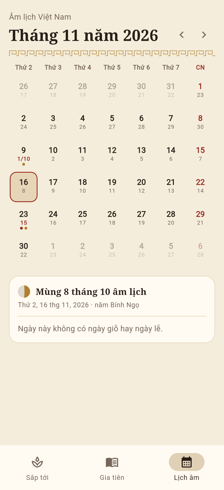
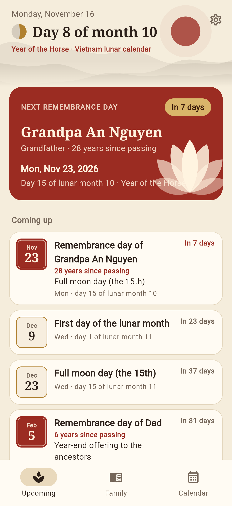
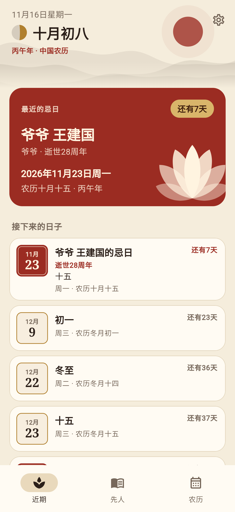
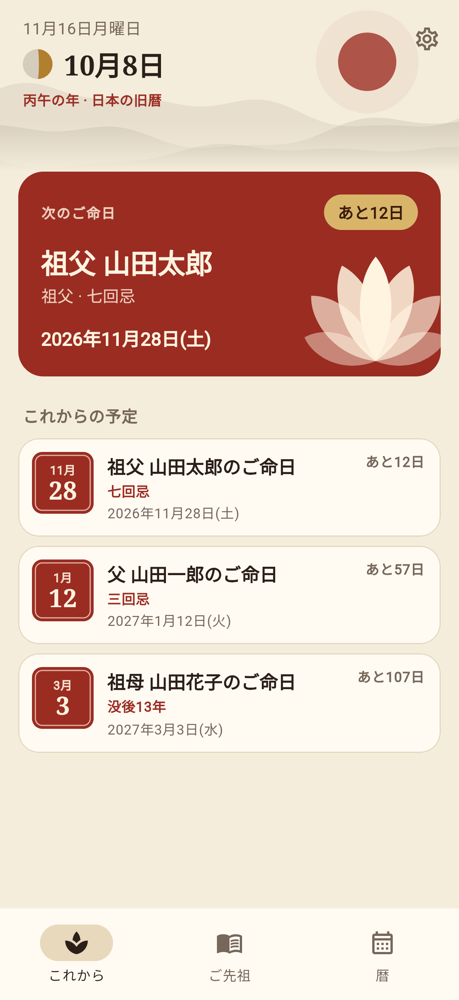
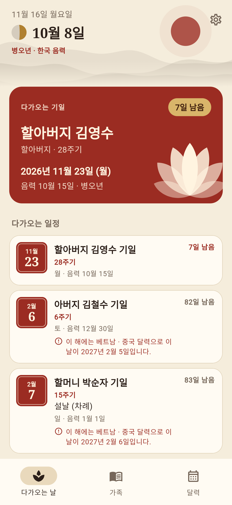

# Nhớ Ngày Giỗ (AncestryDay)

App nhắc ngày giỗ, rằm, mùng một và ngày lễ theo **lịch âm của từng nước**, chạy trên iPhone và Android (Flutter).
Nhập ngày giỗ một lần; mỗi năm app tự đổi ra ngày dương và nhắc trước để kịp chuẩn bị.

| Sắp tới | Sổ ngày giỗ | Ngày giỗ những năm tới | Lịch âm |
|---|---|---|---|
|  |  |  |  |

## Vì sao cần app này

- Ngày giỗ tính theo âm lịch, mỗi năm rơi vào một ngày dương khác, nên rất dễ quên.
- **Lịch âm các nước không giống hệt nhau.** Mỗi nước tính theo múi giờ của mình, nên có năm lệch một ngày, có năm lệch
  cả tháng (Tết 2030: Việt Nam 2/2, Trung Quốc 3/2; Tết 1985 lệch nhau một tháng). Lịch âm có sẵn trên điện thoại
  thường là lịch Trung Quốc. App này hỏi bạn theo lịch nước nào, tính theo đúng lịch đó, và cảnh báo những năm các lịch lệch nhau.

## Có gì trong bản đầu

- Sổ ngày giỗ: ngày mất theo âm lịch hoặc dương lịch, tự đếm giỗ đầu, giỗ hết, giỗ lần thứ mấy.
- Lịch âm Việt Nam, Trung Quốc, Hàn Quốc, Nhật Bản; màn hình liệt kê những khoảng thời gian các lịch lệch nhau.
- Nhắc trước 7 ngày, 3 ngày, 1 ngày và đúng ngày, vào giờ tự chọn.
- Rằm, mùng một, Tết, Thanh minh, Vu Lan, Chuseok, Obon, Higan... bật tắt từng ngày.
- Lịch âm theo tháng, có hình trăng tròn khuyết.
- 6 ngôn ngữ: Việt, Anh, Trung giản thể, Trung phồn thể, Nhật, Hàn.
- Không tài khoản, không cần mạng, dữ liệu chỉ nằm trên máy.

| English | 中文 | 日本語 | 한국어 |
|---|---|---|---|
|  |  |  |  |

## Chạy thử

```bash
flutter pub get
```

```bash
flutter run
```

Kiểm tra trước khi commit:

```bash
flutter analyze && flutter test
```

Mỗi lần đẩy code lên GitHub, GitHub Actions build file APK để cài thử trên điện thoại Android
(tab Actions, mục Artifacts, tên `nho-ngay-gio-apk`).

- Thiết kế, cách tính lịch âm, định dạng dữ liệu ngày lễ: [docs/THIET_KE.md](docs/THIET_KE.md)
- Đưa app lên App Store: [docs/APP_STORE.md](docs/APP_STORE.md)
- Nội dung trang App Store (5 ngôn ngữ): [docs/app-store/listing.md](docs/app-store/listing.md)
